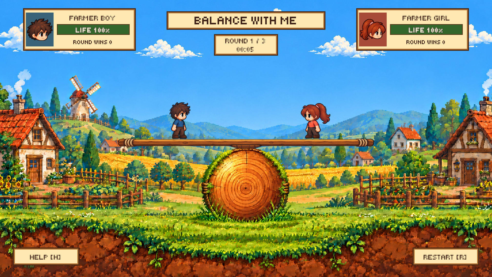

# Balance with me

A local two-player 2D pixel-art game made with Unity and VS Code. A chibi boy and girl share a plank above a round wooden fulcrum in a farming village. Use a shared keyboard, two gamepads, or a mixed setup. Walk, jump, punch, and push your opponent: keep your footing and knock the other player off, or land three punches to win a round.

### Updated match flow — 17 October 2026

- On a fresh Unity checkout, the untouched empty startup scene automatically opens **Main** in the **Game** view, with a 16:9 preview. Both characters are saved in their starting positions and are visible before Play. Use **Balance with me > Open Game Preview** to return to it. Unity still requires Play to run gameplay.
- New character artwork includes four-frame idle, punch and open-palm push sequences for each player. Attacks use full-body poses rather than floating yellow/blue hand boxes.
- Scorecards use separate name, life and score rows. **LIFE % is centered inside the life bar**, including at 0%; **ROUND WINS** sits below it. Win rate has been removed.
- Cute head-only portraits replace full-body HUD icons. Each character has calm, hurt, happy and crying faces; hits briefly change the portrait to hurt, and results show the appropriate happy/crying expression.
- Win a round by landing three punches or making the opponent fall. After a **3.2-second** result/countdown, the next round starts automatically with full health and the match score retained. A draw also advances without awarding a win.
- Matches last **exactly three rounds**, including draws. The player with more round wins wins the match; equal scores show a match draw. After a **five-second** match-result display, a fresh match starts automatically with scores cleared. No restart input is needed.
- Winners play a four-frame fist-pump/hop animation with the original victory jingle. Losers return to the stage for a visible four-frame crying reaction, including after falling. Final reactions use the overall match score, not just the last round's winner.
- Help is available on demand. Tune `nextRoundDelay` and `matchResetDelay` on GameManager. R / Restart / gamepad Start remain optional shortcuts; a restart after a counted result advances without counting that round twice.

The expressive portraits, prominent percentage feedback and clear round-result presentation take inspiration from [Super Smash Bros.' platform-fighting presentation](https://www.smashbros.com/en_US/howtoplay/basic.html). Characters, artwork, scenery and audio remain personalized to this farming game; percentages here represent remaining life.

<p align="center"></p>

> Full 16:9 layout captured from the Unity scene. The plank and circular wooden-log fulcrum share honey-brown timber, matching rope details and visible woodgrain. Grass and moss fringe the fulcrum’s curved rim and base to blend with the land; farmhouses, fields and a windmill frame the central play area. Separate cloud sprites drift slowly across the sky. Character sprite sheets are kept in the project assets and are not displayed in this README.

## Download & play

Source: **[Tinenen-cs/Balance-with-me](https://github.com/Tinenen-cs/Balance-with-me)**. The source is published. **App and APK creation are on hold until the user explicitly requests a build.** Test the game in the Unity Editor. The current setup is ready for a local playtest; follow **How to run** below.

| Device | Planned file / output | How to run |
| --- | --- | --- |
| Windows | `Balance-with-me-Windows.zip` | Pending; inspect the source in Unity for now |
| Android | `Balance-with-me.apk` | Pending; mobile input is not configured |
| macOS | `Balance-with-me-macOS.zip` | On hold; test in Unity instead |
| Browser | WebGL build | Pending; no hosted game link exists |

## Activity: Two-character balance game

| Rule | In the game | Code | Verification |
| --- | --- | --- | --- |
| Two independent players | Boy and girl have separate keyboard bindings | `PlayerActions.Update` | Keyboard PlayMode test |
| Grounded jumping | W / Up Arrow request a jump | `CharacterController2DP2.Move` | Both-player jump test |
| Punch | Short forward strike; one health point and knockback per attack | `PlayerActions.AdvanceAction` | Single-hit, cooldown, facing and reach tests |
| Push | Forward shove; sustained knockback with no health damage | `PlayerActions.AdvanceAction` | Push physics test |
| Face the target and stay in range | Hits require the opponent ahead within 1.2 world units horizontally and vertically | `PlayerActions.AdvanceAction` | Facing/reach test |
| Cooldowns | Punch 0.65 s; push 0.9 s | `PlayerActions.TryAction` | Repeated attack rejected |
| Hit reaction | Brief stun and red flash; movement cannot immediately cancel knockback | `PlayerActions.Receive` | Stun/knockback tests |
| Win and advance | Zero health or falling ends a round; play three rounds, show the total-score result, then reset automatically | `BalanceGame` | Round, draw, match completion and restart tests |

The plank is a Rigidbody2D hinged at its center with ±16° limits and a gentle centering torque. The plank is supported visually by a centered circular wooden log resting on the foreground land. The support is stationary.

### Recording the video (about 2 minutes)

1. Open **Assets → Scenes → Main**, select **Desktop 1920 × 1080**, and press Play.
2. Start recording, then move both characters toward each other using **A/D** and **Left/Right Arrow**.
3. Demonstrate **W** / **Up Arrow** jumps.
4. Face the opponent and press **F** / **K** to punch. Show the wind-up, extended fist, recovery, hit flash, knockback, and life percentage decrease.
5. Press **G** / **L** to push. Show the open-palm shove animation without health loss.
6. Win by landing three punches or knocking the other player off. Play all three rounds, watch the winner/loser reactions, and let the next match start automatically.

## Status

| Step | Feature | Status |
| --- | --- | --- |
| 1 | Desktop 16:9 Unity project and URP 2D configuration | Implemented |
| 2 | Original boy/girl sprites, farmer-village background and plank sprite | Included |
| 3 | Playable Main scene and scene rebuild menu | Implemented |
| 4 | Keyboard movement, jumping and existing sprite animation playback | Implemented |
| 5 | Punch, push, cooldowns, stun, knockback and health | Implemented |
| 6 | Hinged plank, win detection and restart | Implemented |
| 7 | Gamepad routing, two music loops, reaction sounds and emotes | Implemented |
| 8 | PlayMode tests and Unity layout capture | See validation notes |
| 9 | App/APK builds | On hold until requested |
| 10 | Touch controls and dedicated combat sprite frames | Future polish |

## Features

- **Local two-player controls** for walking, jumping, punching and pushing, with shared-keyboard, two-gamepad and mixed input.
- **Gamepad hot-plugging:** the first connected gamepad controls the boy, the second controls the girl. Disconnecting one preserves the other player’s assignment; keyboard controls remain available.
- **Original audio:** two switchable looping music tracks, footsteps, jump/landing, punch/push and hit/shove sounds, happy/sad emote jingles, and separate fail/win/draw cues. Mute is remembered.
- **Emotes:** alternate happy/sad speech labels and jingles above each player. The winner automatically celebrates with a golden “I DID IT!” popup, bouncing and rocking for 2.4 seconds, accompanied by the victory jingle. Draws have no winner emote; restart clears it.
- **Distinct attacks:** punch damages and knocks back once; push shoves throughout its active window without damage.
- **Action effects:** footstep dust, jump/landing puffs, hit sparks and shove particles accompany full-body attack animation. Happy emotes sparkle, sad emotes shed blue droplets, winners burst confetti, and losing/respawning characters get brief puffs/leaves. [See the combat preview](Docs/action_effects.png).
- **Combat feedback:** dedicated four-frame punch and push sequences, red hit flash and hurt frames.
- **Farm-themed scorecards** show expressive head portraits, percentages inside wide life bars, and round wins on a separate line. The round timer pauses at the result and resets automatically for the next round.
- **Wood-and-parchment UI** keeps names, life, wins, round/time, title, Help and Restart visible. Controls appear for five seconds on demand; round-start and audio notices disappear after 2.5 seconds. Round results count down to the next round; match results count down to a fresh match.
- **Smooth motion:** interpolated player/plank physics, 0.08-second movement smoothing and eased action/emote poses. The weighted plank uses angular damping and progressive resistance before its ±16° hinge limits. Restart clears stored movement smoothing.
- **Physics scene:** player Rigidbody2Ds and capsule colliders on a hinged plank.
- **24 new character frames** provide idle, punch and push animations; the original sheet supplies walk, jump and hurt animations.
- **16 result animation frames and eight head portraits** provide individual victory, crying and HUD reactions for both players.
- **Slow moving clouds:** five transparent pixel-art clouds drift gently across the sky at different speeds and wrap completely offscreen. They keep moving between rounds.
- **Desktop 16:9 farming village** with farmhouses, fields, clouds, a windmill and a grass-trimmed round wooden fulcrum supporting the plank.
- **Original source retained:** `CharacterController2DP2.bin` is unchanged; the active controller uses Unity 6 `linearVelocity` instead of deprecated `velocity`. Companion scripts were added after the user authorized new code.

## Action effects

| Character action | Visual feedback |
| --- | --- |
| Walk | Small trailing dust puffs on grounded footsteps |
| Jump / land | Takeoff dust / a wider landing puff |
| Punch / hit | Full-body fist animation / brief impact sparks |
| Push / shove | Full-body open-palm shove / short knockback particles |
| Happy / sad emote | Gold sparkles / falling blue droplets |
| Win / fail | Gold, green and coral confetti / a brief earthy puff |
| Restart / spawn | Old effects clear, followed by small green leaf particles |

Effects are brief, fade out automatically and use a fixed sprite pool per character. Accepted attacks trigger their effect once; blocked cooldown inputs do not spawn extra effects. Sounds remain synchronized with movement, attacks and reactions.

## Controls

| Action | Boy | Girl |
| --- | --- | --- |
| Move left / right | A / D | Left / Right Arrow |
| Jump | W | Up Arrow |
| Punch | F | K |
| Push | G | L |
| Emote (happy / sad) | E | O |
| Restart round | R or RESTART button | R or RESTART button |
| Mute / unmute | M | M |
| Next music track | N | N |
| Show controls briefly | H or HELP button | H or HELP button |

### Gamepad controls

Connect supported gamepads by USB or Bluetooth before or during play. The first pad controls the boy and the second controls the girl. With one pad, use it for the boy and the arrow-key controls for the girl. Keyboard bindings stay active for both players.

| Action | Xbox / generic | PlayStation |
| --- | --- | --- |
| Move | Left stick or D-pad | Left stick or D-pad |
| Jump | A | Cross |
| Punch | X | Square |
| Push | B | Circle |
| Emote | Y | Triangle |
| Restart | Start / Menu | Options |
| Mute | Select / View | Share / Create |
| Next music | Right bumper | R1 |
| Show controls briefly | Left bumper | L1 |

Gamepad input is tested with simulated Input System devices. Physical controller compatibility should be checked on your device.

Click the Game view to give it keyboard focus. Attack while facing the other player and close enough to reach them. Crouching remains available in the original controller API but is not bound in this game.

## Tuning the controller

1. Player display names can be edited on **GameManager → Boy Name / Girl Name**. Select **Boy** or **Girl** in the Main scene. Their Rigidbody2D, capsule collider, Ground Check, Ceiling Check and ground mask are already wired.
2. Tune jump force, movement smoothing (default 0.08 seconds) and air control in **CharacterController2DP2**. Character and plank Rigidbody2Ds use Interpolate to smooth their rendered movement between physics steps.
3. Combat reach, duration, damage, stun and cooldowns are in `PlayerActions.cs`. Movement speed is passed to the controller there.
4. Tune the plank's Rigidbody2D mass (7), angular damping (2.5) and HingeJoint2D limits (±16°) in the Inspector. GameManager exposes Centering Torque (0.75), Edge Resistance (4) and Soft Limit Angle (11°) for the progressive swing resistance. Physics runs at 50 Hz; rendering uses interpolation.
5. Adjust each **Drifting Clouds → Slow Cloud → Cloud Drift → Speed** in the Inspector (defaults 0.06–0.108 world units per second). Keep Edge Padding positive so clouds wrap beyond the viewport. Put repeatable cloud layout changes in `PlayableSceneBuilder.BuildClouds`.
6. Tune particle colors, sizes and lifetime in `ActionEffects.cs`. Each player has a fixed pool of 64 effect sprites by default; walking and shove effects share existing audio throttles. Restart clears old particles before the spawn effect.
7. Use **Balance with me → Capture Full Layout** to refresh the README screenshot in the Editor; it does not create an app. The scene rebuild menu regenerates references and resets scene-only edits. Put repeatable setup changes in `PlayableSceneBuilder.cs` before using **Balance with me → Rebuild Playable Scene**. **Capture Action Effects** stages a punch/push exchange and saves `Docs/action_effects.png`; it also runs only inside the Editor.

## Screen layout

Desktop **16:9**, with a camera showing 19.2 × 10.8 world units and a **1920 × 1080** UI Canvas reference. The boy and girl begin at opposite ends of the rope-bound plank; its central saddle meets the circular wooden support. Symmetrical parchment player scorecards, with matching boy/girl character icons beside their names, flank the centered title and round clock. Small Help and Restart signs sit in opposite bottom corners. The controls panel is a five-second popup (H / left bumper / HELP); audio status appears only after M / N or the corresponding gamepad input. Emote and reaction words appear briefly near the players; result labels sit below them to keep the central banner clear. Round results count down automatically to the next round; the match result starts a fresh match automatically after five seconds.

Desktop defaults are a resizable 1920 × 1080 window; browser defaults are 1280 × 720. Select **16:9** or **Desktop 1920 × 1080** manually in Unity's Game view. The farming-village background uses uniform overscan to fill the view, preserve the round wooden fulcrum’s proportions and align its top with the plank.

## Unity version and packages

- Target: **Unity 6.3 LTS — 6000.3.24f1**, matching the reference repository.
- Windows validation on 17 October 2026 uses **6000.3.24f1**: compilation and all 32 PlayMode tests pass. Previous validation used **6000.3.26f1**.
- URP 2D, 2D Sprite, 2D Animation, Input System, uGUI, and Unity Test Framework package configuration is in `Packages/manifest.json`.
- VS Code extension recommendations are in `.vscode/extensions.json`.

## Project structure

```text
Assets/
  Art/
    Characters/two_players.png     original character sheet
    Characters/combat_players.png  new idle, punch and push sequences
    Characters/result_players.png  four-frame win/cry sequences for both players
    Characters/Generated/          shared unlit sprite material
    Backgrounds/farm_village_wood_ball.png  cloudless village and round wooden fulcrum
    Backgrounds/moving_cloud.png          transparent drifting cloud sprite
    Props/farm_balance_plank.png     rustic rope-bound plank and central saddle
    Fonts/Tiny5.ttf                pixel font, with SIL OFL license
    UI/pixel_hand.png               native pixel hand effect
    UI/character_portraits.png      calm, hurt, happy and crying head portraits
    Icon/                          reserved app icon
  Audio/Music/                     two original background loops
  Audio/SFX/                       thirteen original movement/action/reaction/emote/result cues
  Editor/PlayableSceneBuilder.cs   rebuilds the playable scene and wires references
  Editor/ProjectStartup.cs         opens the saved game preview on a fresh checkout
  Editor/LayoutScreenshot.cs       captures the full scene for the README
  Scenes/Main.unity                playable desktop scene
  Scripts/
    Players/CharacterController2DP2.cs  movement motor (Unity 6 API update)
    Players/PlayerActions.cs        keyboard/gamepad actions, combat, reactions and emotes
    Players/ActionEffects.cs        pooled fading pixel effects for all actions
    Players/LocalInputRouter.cs     stable gamepad assignments and hot-plugging
    Audio/GameAudio.cs              looping music, named cues and persistent mute
    World/BalanceGame.cs            health, winner/restart, global input and audio
    World/CloudDrift.cs             slow cloud movement and offscreen wrapping
    BalanceWithMe.Runtime.asmdef    runtime assembly definition
  Data/                            reserved tuning assets
  Settings/                        URP 2D configuration
  Tests/PlayMode/                  combat, keyboard/gamepad, audio and round-flow tests
Docs/
  gameplay_layout.png              current full desktop layout captured in Unity
  layout_preview.png               archived original art concept
  generation_prompts.json          image prompts
  ASSET_GUIDE.md                   artwork information
  DEVELOPMENT.md                  implementation notes
  VALIDATION.md                   check results and limitations
Packages/                          package manifest and lock
ProjectSettings/                   Unity configuration
Tools/make_audio.py                reproducible original WAV synthesis
.vscode/                           VS Code recommendations
CharacterController2DP2.bin         unchanged original supplied source
```

## Audio credits

All included audio is original synthesis generated for this project with `Tools/make_audio.py` (Python standard library). No third-party recordings, songs or music packs are used.

| Files | Plays when | Source |
| --- | --- | --- |
| `Music/sky_breeze.wav` | Default mellow background loop | Original synthesis |
| `Music/playful_balance.wav` | Alternate upbeat background loop (N / right bumper) | Original synthesis |
| `SFX/step.wav`, `land.wav` | Grounded walking (throttled) / landing after airtime | Original synthesis |
| `SFX/jump.wav` | Accepted grounded jump | Original synthesis |
| `SFX/punch.wav`, `push.wav` | Attack starts | Original synthesis |
| `SFX/hit.wav`, `shove.wav` | Opponent reacts; repeated shove sounds are throttled | Original synthesis |
| `SFX/emote_happy.wav`, `emote_sad.wav` | E / O / gamepad north button emote | Original synthesis |
| `SFX/fail.wav` | A player falls or loses all health; plays before the result jingle | Original synthesis |
| `SFX/start.wav`, `win.wav`, `draw.wav` | Round restart / result; the win jingle accompanies the winner’s automatic celebration; restart cancels a pending result jingle | Original synthesis |

Use **M** or the gamepad Select/View button to mute all sound; the setting is saved locally. Use **N** or the right bumper to switch tracks. Music and effects volumes are exposed on the Audio System's AudioSources. Regenerate the WAVs with `python3 Tools/make_audio.py`, then rebuild the scene if clip references need updating.

## Art and font credits

| Asset | Source | License / attribution |
| --- | --- | --- |
| Characters, farmer village, cloud sprite, wooden fulcrum and farm plank | Original images generated for this project using built-in imagegen | Prompts recorded in `Docs/generation_prompts.json`; no separate asset license assigned |
| Tiny5 pixel font | [Tiny5 via Google Fonts](https://github.com/google/fonts/tree/main/ofl/tiny5), The Tiny5 Project Authors | SIL Open Font License 1.1; `Assets/Art/Fonts/Tiny5-OFL.txt` |
| Project and URP configuration | Official Unity 2D template from the installed editor | Unity-provided configuration |
| CharacterController2DP2 | User-supplied original retained as `.bin`; active `.cs` updated for Unity 6 APIs | Redistribution license not provided |

README section organization follows the supplied [CSEL Tamagotchi reference](https://github.com/Tinenen-cs/Tinenen-cs-csel-tamagotchi). No Stardew Valley game assets are included. No repository-wide license has been selected.

---

## How to run

### A. Mac (Terminal)

1. Get the published project:
   ```bash
   git clone https://github.com/Tinenen-cs/Balance-with-me.git
   cd Balance-with-me
   ```
   For the existing local copy, use `/Users/imac23/Documents/TWOCHARACTERGAME_CSEL`. Update a clean checkout with `git pull origin main`.
2. Install **Unity Hub**. The recorded project version is **6000.3.24f1**, matching the reference and now verified on Windows with all 32 PlayMode tests passing. Previous macOS compilation, tests and captures used **6000.3.26f1**; you may select that installed version in Hub and accept the patch upgrade.
3. In Hub, select **Projects → Add → Add project from disk**. Choose the folder containing `Assets`, `Packages`, and `ProjectSettings`.
4. Open the project and allow package restoration and asset import to finish.
5. Open **Assets → Scenes → Main**. To regenerate the playable setup, use **Balance with me → Rebuild Playable Scene**.
6. In the Game view resolution dropdown, add **Desktop**, Fixed Resolution **1920 × 1080**, or select a 16:9 aspect.
7. Press **Play**, click the Game view, and use the keyboard or connect gamepads. Move close to the opponent before attacking. Press H / left bumper / HELP to briefly show controls. Test E/O or the gamepad north button for emotes; M mutes and N changes music. Listen for footsteps, jump/landing, both attacks and hit reactions; losing a round plays a fail cue followed by the result jingle.
8. Open the same root folder in **VS Code**. The recommended extensions are listed in `.vscode/extensions.json`. Edit the movement, actions, or round scripts as needed; the original `.bin` remains available for comparison.
9. Run **Window → General → Test Runner → PlayMode → Run All**. See [validation notes](Docs/VALIDATION.md) for results and limits.

### Test-run in the Unity Editor (Windows, step by step)

1. Clone the repository, or use an existing copy of the source.
2. Open **Unity Hub** from the Start menu.
3. Select **Projects → Add → Add project from disk** and choose the root project folder.
4. Select **6000.3.24f1**, the recorded project version verified on Windows. Previous validation also used **6000.3.26f1**. Open the project.
5. Wait for Unity to import assets and restore packages.
6. In the Project window, open **Assets → Scenes → Main**.
7. Add a **Desktop 1920 × 1080** Game view resolution; reduce the Scale slider if the preview is too large.
8. Press **Play**. Test both players moving and jumping, then walk toward each other and try punching and pushing.
9. Open **Window → General → Console** to review messages. The active controller now uses Unity 6 `Rigidbody2D.linearVelocity`.
10. Confirm punch/push reactions, happy/sad emotes, music switching and mute. Win a round and check the winner’s brief golden emote and victory animation/jingle. Check both name cards show the correct character icon. Press R and verify the celebration clears and wins remain while health and time reset. Press **Play** again to exit.
11. Open **Window → General → Test Runner → PlayMode → Run All** to run combat, keyboard/gamepad, audio and round-flow tests.

### B. Other devices

#### Browser (any phone or computer)

No hosted browser version is available. After target-platform validation, install **WebGL Build Support** and use Unity's **File → Build Profiles** to create a WebGL build. Browser and touch behavior remain unverified.

#### Android phone

No APK is available. Future builds require **Android Build Support**, including SDK/NDK and OpenJDK, installed through Unity Hub. Configure an Android build profile after target-platform validation. No touch controls are implemented.

#### iPhone (needs a Mac with Xcode)

No iOS build is available. Future device testing requires the Unity **iOS Build Support** module and Xcode. iOS input, signing, and device behavior have not been configured or validated.

#### Windows / Linux / macOS

Use the Unity Editor to play the game now. Standalone builds are on hold at the user’s request. Do not create or publish an app until the user requests it. Use the instructions above to test the scene in Unity.

## Troubleshooting

### Unity opens an empty scene

The playable game is saved in `Assets/Scenes/Main.unity`. The project now opens it automatically when Unity starts with an untouched empty scene. Saved scenes and unsaved work are preserved. Use **Balance with me > Open Game Preview** if needed, or follow the manual steps below.

1. Add the root folder containing `Assets`, `Packages`, and `ProjectSettings` in Unity Hub, then open it with **6000.3.24f1**.
2. Wait for imports and script compilation to finish.
3. In Unity's **Project** window, double-click **Assets > Scenes > Main** (the `Main.unity` file). The Hierarchy should include **GameManager**, **Boy**, **Girl**, and **Balancing Plank**.
4. Select the **Game** tab and press **Play**. Click inside the Game view to use the keyboard.

An empty **Untitled** scene does not mean the game is missing. Open Main before rebuilding anything; **Rebuild Playable Scene** replaces scene edits. If Main still fails to load, check **Window > General > Console** for red errors.

If Unity Hub on this Mac reports **Code=-600 / procNotFound** when opening the editor, launch the installed Unity executable directly from Terminal:

```bash
"/Applications/Unity/Hub/Editor/6000.3.26f1/Unity.app/Contents/MacOS/Unity" -projectPath "/Users/imac23/Documents/TWOCHARACTERGAME_CSEL"
```

This opens the project in the Editor for testing. Wait for Unity to finish loading, open `Assets/Scenes/Main.unity`, and press Play. Use your actual installation and project paths on another device. The Hub logs are under `~/Library/Application Support/UnityHub/logs`; the project’s batchmode compilation, test runs and graphical capture succeeded with this installed editor executable.

- **No sound:** press M to unmute, check the computer output volume and Unity’s Game-view audio mute. The Audio System has separate music and effect sources.
- **Gamepad does nothing:** focus the Game view and verify the controller appears in Unity’s Input Debugger. The first connected pad controls the boy.
- **Keys do nothing:** click the Game view and check that Input System has imported. Open Main or rebuild it with **Balance with me → Rebuild Playable Scene**.
- **Attack misses:** face the opponent and move within 1.2 world units. Hits also require similar vertical positions.
- **Cannot immediately attack again:** wait for the punch/push cooldown. Stunned players cannot start attacks.
- **Push does not reduce health:** intentional; it is a knockback-only action.
- **Original `.bin` differs from the active `.cs`:** the original is retained; the active motor received the authorized Unity 6 API update.
- **Manual scene edits disappear:** the rebuild menu regenerates Main. Store repeatable setup in the builder or avoid rebuilding after Inspector-only edits.
- **Version prompt:** target is 6000.3.24f1; local verification used 6000.3.26f1.
- **Combat animation:** punch and push use the new dedicated character frames. Their timing follows the attack window; particles are reserved for contact, movement and reactions.

## Contributing

New and edited scripts are now authorized. Keep the original `CharacterController2DP2.bin` as a reference. For each completed change:

```bash
git pull origin main
git checkout -b feature/short-name
# Make changes in Unity / VS Code.
# Run PlayMode tests and inspect the scene in Unity.
git add Assets Docs Packages ProjectSettings README.md
git commit -m "Describe the completed change"
git push -u origin feature/short-name
# Open a pull request on GitHub.
```

Commit asset `.meta` files, update status and validation notes, and exclude Unity caches, logs, local builds and credentials.
