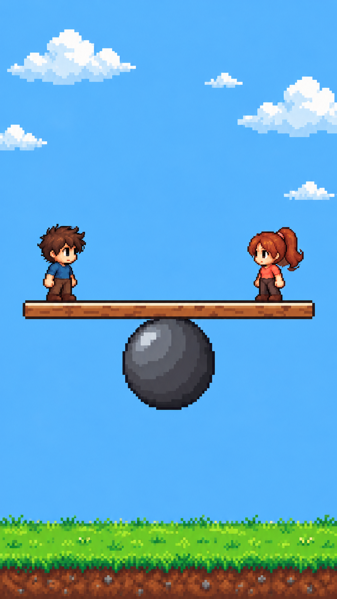
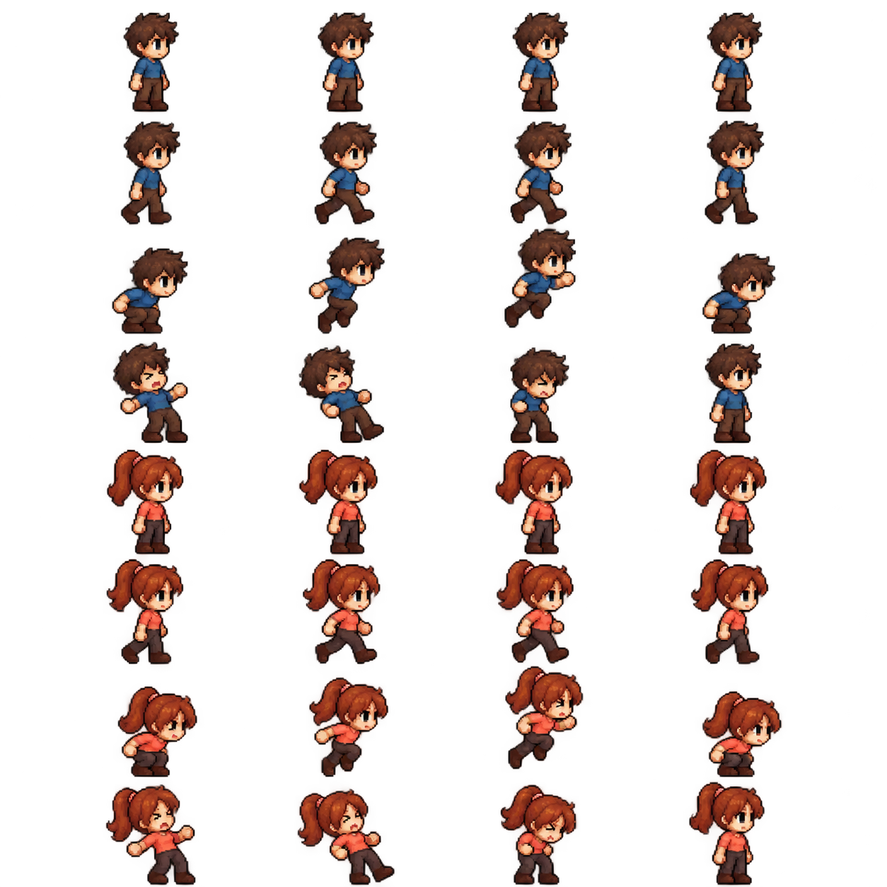

# Balance with me

A local two-player 2D pixel-art game made with Unity and VS Code. A chibi boy and girl share a plank above a large ball. Walk, jump, punch, and push your opponent: keep your footing and knock the other player off, or land three punches to win.

<p align="center"></p>

<p align="center"></p>

> Images above: original portrait art concept and the character animation sheet. The playable Main scene uses the desktop 16:9 layout described below. Neither image is a gameplay screenshot. Punch and push feedback uses simple pixel hand effects alongside the existing character sprites; separate punch/push sprite-sheet frames have not been drawn.

## Download & play

Source: **[Tinenen-cs/Balance-with-me](https://github.com/Tinenen-cs/Balance-with-me)**. The source is published. No packaged builds are available yet; run the Main scene in Unity.

| Device | Planned file / output | How to run |
| --- | --- | --- |
| Windows | `Balance-with-me-Windows.zip` | Pending; inspect the source in Unity for now |
| Android | `Balance-with-me.apk` | Pending; mobile input is not configured |
| macOS | `Balance-with-me-macOS.zip` | Pending; inspect the source in Unity for now |
| Browser | WebGL build | Pending; no hosted game link exists |

## Activity: Two-character balance game

| Rule | In the game | Code | Verification |
| --- | --- | --- | --- |
| Two independent players | Boy and girl have separate keyboard bindings | `PlayerActions.Update` | Keyboard PlayMode test |
| Grounded jumping | W / Up Arrow request a jump | `CharacterController2DP2.Move` | Both-player jump test |
| Punch | Short forward strike; one health point and knockback per attack | `PlayerActions.AdvanceAction` | Single-hit, cooldown, facing and reach tests |
| Push | Forward shove; sustained knockback with no health damage | `PlayerActions.AdvanceAction` | Push physics test |
| Face the target and stay in range | Hits require the opponent ahead within 1.2 world units horizontally and vertically | `PlayerActions.AdvanceAction` | Facing/reach test |
| Cooldowns | Punch 0.65 s; push 0.9 s | `PlayerActions.TryAction` | Repeated attack rejected |
| Hit reaction | Brief stun and red flash; movement cannot immediately cancel knockback | `PlayerActions.Receive` | Stun/knockback tests |
| Win and restart | Opponent reaches zero health or falls below the board; R/button resets the round | `BalanceGame` | Falling and restart tests |

The plank is a Rigidbody2D hinged at its center with ±16° limits and a gentle centering torque. The large ball is a stationary visual support; free ball rolling is not implemented.

### Recording the video (about 2 minutes)

1. Open **Assets → Scenes → Main**, select **Desktop 1920 × 1080**, and press Play.
2. Start recording, then move both characters toward each other using **A/D** and **Left/Right Arrow**.
3. Demonstrate **W** / **Up Arrow** jumps.
4. Face the opponent and press **F** / **K** to punch. Show the orange fist, red hit flash, knockback, and health decrease.
5. Press **G** / **L** to push. Show the cyan hand effect and shove without health loss.
6. Win by landing three punches or knocking the other player off. Press **R** or **RESTART** to reset.

## Status

| Step | Feature | Status |
| --- | --- | --- |
| 1 | Desktop 16:9 Unity project and URP 2D configuration | Implemented |
| 2 | Original boy/girl sprites, background and separate plank/ball slices | Included |
| 3 | Playable Main scene and scene rebuild menu | Implemented |
| 4 | Keyboard movement, jumping and existing sprite animation playback | Implemented |
| 5 | Punch, push, cooldowns, stun, knockback and health | Implemented |
| 6 | Hinged plank, win detection and restart | Implemented |
| 7 | PlayMode tests | See validation notes |
| 8 | Audio, touch controls, dedicated combat sprite frames and platform builds | Pending |

## Features

- **Local two-player controls** for walking, jumping, punching and pushing.
- **Distinct attacks:** punch damages and knocks back once; push shoves throughout its active window without damage.
- **Combat feedback:** orange punch fist, cyan push hand, red hit flash and hurt frames.
- **Three health points each**, a winner message, and keyboard/button restart.
- **Physics scene:** player Rigidbody2Ds and capsule colliders on a hinged plank.
- **32 original animation frames** used for idle, walk, jump and hurt, plus programmatic combat hand effects.
- **Desktop 16:9 composition** with clouds, green land, a plank, and a large support ball.
- **Original source retained:** `CharacterController2DP2.bin` is unchanged; the active controller uses Unity 6 `linearVelocity` instead of deprecated `velocity`. Companion scripts were added after the user authorized new code.

## Controls

| Action | Boy | Girl |
| --- | --- | --- |
| Move left / right | A / D | Left / Right Arrow |
| Jump | W | Up Arrow |
| Punch | F | K |
| Push | G | L |
| Restart round | R or RESTART button | R or RESTART button |

Click the Game view to give it keyboard focus. Attack while facing the other player and close enough to reach them. Crouching remains available in the original controller API but is not bound in this game.

## Tuning the controller

1. Select **Boy** or **Girl** in the Main scene. Their Rigidbody2D, capsule collider, Ground Check, Ceiling Check and ground mask are already wired.
2. Tune jump force, movement smoothing and air control in **CharacterController2DP2**.
3. Combat reach, duration, damage, stun and cooldowns are in `PlayerActions.cs`. Movement speed is passed to the controller there.
4. Tune the plank's Rigidbody2D mass, angular damping and HingeJoint2D limits in the Inspector.
5. The scene rebuild menu regenerates references and resets scene-only edits. Put repeatable setup changes in `PlayableSceneBuilder.cs` before using **Balance with me → Rebuild Playable Scene**.

## Screen layout

Desktop **16:9**, with a camera showing 19.2 × 10.8 world units and a **1920 × 1080** UI Canvas reference. The boy and girl begin at opposite ends of the plank; the ball sits directly beneath its center. Title, health and round status appear above the board; controls and restart appear below it.

Desktop defaults are a resizable 1920 × 1080 window; browser defaults are 1280 × 720. Select **16:9** or **Desktop 1920 × 1080** manually in Unity's Game view. The portrait background is stretched to fill the landscape world view.

## Unity version and packages

- Target: **Unity 6.3 LTS — 6000.3.24f1**, matching the reference repository.
- Local compile validation uses installed **6000.3.26f1**; exact-target-version validation is pending.
- URP 2D, 2D Sprite, 2D Animation, Input System, uGUI, and Unity Test Framework package configuration is in `Packages/manifest.json`.
- VS Code extension recommendations are in `.vscode/extensions.json`.

## Project structure

```text
Assets/
  Art/
    Characters/two_players.png     original character sheet
    Characters/Generated/          trimmed sprite assets, plank/ball slices, pixel effects and unlit material
    Backgrounds/                   clouds and green land
    Props/                         original platform-and-ball texture
    UI/, Fonts/, Icon/             reserved art and font notes
  Audio/                           reserved audio and credits
  Editor/PlayableSceneBuilder.cs   rebuilds the playable scene and wires references
  Scenes/Main.unity                playable desktop scene
  Scripts/
    Players/CharacterController2DP2.cs  movement motor (Unity 6 API update)
    Players/PlayerActions.cs        keyboard input, combat, knockback and sprite feedback
    World/BalanceGame.cs            health display, hinged-board centering, winner and restart
    BalanceWithMe.Runtime.asmdef    runtime assembly definition
  Data/                            reserved tuning assets
  Settings/                        URP 2D configuration
  Tests/PlayMode/PlayerActionTests.cs  combat, input, jump and round-flow tests
Docs/
  layout_preview.png               original art composition, not gameplay capture
  generation_prompts.json          image prompts
  ASSET_GUIDE.md                   artwork information
  DEVELOPMENT.md                  implementation notes
  VALIDATION.md                   check results and limitations
Packages/                          package manifest and lock
ProjectSettings/                   Unity configuration
Tools/                             reserved
.vscode/                           VS Code recommendations
CharacterController2DP2.bin         unchanged original supplied source
```

## Audio credits

No music or sound effects are included yet. Store future licensed audio in `Assets/Audio` and document its source and license here.

## Art and font credits

| Asset | Source | License / attribution |
| --- | --- | --- |
| Characters, background, plank/ball, layout preview | Original images generated for this project using built-in imagegen | Prompts recorded in `Docs/generation_prompts.json`; no separate asset license assigned |
| UI text | Unity built-in font | Unity-provided resource |
| Project and URP configuration | Official Unity 2D template from the installed editor | Unity-provided configuration |
| CharacterController2DP2 | User-supplied original retained as `.bin`; active `.cs` updated for Unity 6 APIs | Redistribution license not provided |

README section organization follows the supplied [CSEL Tamagotchi reference](https://github.com/Tinenen-cs/Tinenen-cs-csel-tamagotchi). No Stardew Valley game assets are included. No repository-wide license has been selected.

---

## How to run

### A. Mac (Terminal)

1. After the local commits have been published, get the project:
   ```bash
   git clone https://github.com/Tinenen-cs/Balance-with-me.git
   cd Balance-with-me
   ```
   For the existing local copy, use `/Users/imac23/Documents/TWOCHARACTERGAME_CSEL`. Once the remote is populated, update a clean checkout with `git pull origin main`.
2. Install **Unity Hub**, then editor **6000.3.24f1**. Choose that exact patch to match the reference project's version.
3. In Hub, select **Projects → Add → Add project from disk**. Choose the folder containing `Assets`, `Packages`, and `ProjectSettings`.
4. Open the project and allow package restoration and asset import to finish.
5. Open **Assets → Scenes → Main**. To regenerate the playable setup, use **Balance with me → Rebuild Playable Scene**.
6. In the Game view resolution dropdown, add **Desktop**, Fixed Resolution **1920 × 1080**, or select a 16:9 aspect.
7. Press **Play**, focus the Game view and use the controls above. Move close to the opponent before attacking.
8. Open the same root folder in **VS Code**. The recommended extensions are listed in `.vscode/extensions.json`. Edit the movement, actions, or round scripts as needed; the original `.bin` remains available for comparison.
9. Run **Window → General → Test Runner → PlayMode → Run All**. See [validation notes](Docs/VALIDATION.md) for results and limits.

### Test-run in the Unity Editor (Windows, step by step)

1. Clone the repository after publication, or use an existing copy of the source.
2. Open **Unity Hub** from the Start menu.
3. Select **Projects → Add → Add project from disk** and choose the root project folder.
4. Confirm the editor version is **6000.3.24f1**, then open the project.
5. Wait for Unity to import assets and restore packages.
6. In the Project window, open **Assets → Scenes → Main**.
7. Add a **Desktop 1920 × 1080** Game view resolution; reduce the Scale slider if the preview is too large.
8. Press **Play**. Test both players moving and jumping, then walk toward each other and try punching and pushing.
9. Open **Window → General → Console** to review messages. The active controller now uses Unity 6 `Rigidbody2D.linearVelocity`.
10. Confirm health decreases after punches, stays unchanged during pushes, and resets with R. Press **Play** again to exit.
11. Open **Window → General → Test Runner → PlayMode → Run All** to run the action and round-flow tests.

### B. Other devices

#### Browser (any phone or computer)

No hosted browser version is available. After target-platform validation, install **WebGL Build Support** and use Unity's **File → Build Profiles** to create a WebGL build. Browser and touch behavior remain unverified.

#### Android phone

No APK is available. Future builds require **Android Build Support**, including SDK/NDK and OpenJDK, installed through Unity Hub. Configure an Android build profile after target-platform validation. No touch controls are implemented.

#### iPhone (needs a Mac with Xcode)

No iOS build is available. Future device testing requires the Unity **iOS Build Support** module and Xcode. iOS input, signing, and device behavior have not been configured or validated.

#### Windows / Linux / macOS

Use the Unity Editor to play the game now. Standalone builds are pending. Once target-platform validation is complete, install the corresponding editor build module and use **File → Build Profiles**. Build profiles are available; no custom build script is included.

## Troubleshooting

- **Keys do nothing:** click the Game view and check that Input System has imported. Open Main or rebuild it with **Balance with me → Rebuild Playable Scene**.
- **Attack misses:** face the opponent and move within 1.2 world units. Hits also require similar vertical positions.
- **Cannot immediately attack again:** wait for the punch/push cooldown. Stunned players cannot start attacks.
- **Push does not reduce health:** intentional; it is a knockback-only action.
- **Original `.bin` differs from the active `.cs`:** the original is retained; the active motor received the authorized Unity 6 API update.
- **Manual scene edits disappear:** the rebuild menu regenerates Main. Store repeatable setup in the builder or avoid rebuilding after Inspector-only edits.
- **Version prompt:** target is 6000.3.24f1; local verification used 6000.3.26f1.
- **Character animation needs polish:** existing frames and simple hand effects provide action feedback. Dedicated punch/push artwork remains future work.

## Contributing

New and edited scripts are now authorized. Keep the original `CharacterController2DP2.bin` as a reference. For each completed change:

```bash
git pull origin main
git checkout -b feature/short-name
# Make changes in Unity / VS Code.
# Run PlayMode tests and inspect the scene in Unity.
git add Assets Docs Packages ProjectSettings README.md
git commit -m "Describe the completed change"
git push -u origin feature/short-name
# Open a pull request on GitHub.
```

Commit asset `.meta` files, update status and validation notes, and exclude Unity caches, logs, local builds and credentials.
